<div align="center">

# ☁️ AWS High Availability Web Application

### A website that **stays online**, even when a server (or a whole data centre) fails.


-232F3E?style=for-the-badge&logo=amazonaws&logoColor=white)


<br>

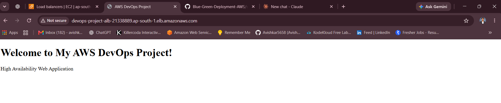

<sub>👆 <b>The finished result:</b> one web address, served by two servers in two different data centres.</sub>

</div>

---

## 📑 Table of Contents

1. [The Problem](#-the-problem-in-plain-english)
2. [The Solution](#-the-solution)
3. [Architecture](#-architecture)
4. [AWS Services Used and Why](#-aws-services-used-and-why)
5. [How High Availability Works](#-how-high-availability-works)
6. [Demo and Screenshots](#-demo-and-screenshots)
7. [Step-by-Step Implementation](#-step-by-step-implementation)
8. [Failure Test (Prove It Works)](#-failure-test-prove-it-works)
9. [Challenges and What I Learned](#-challenges-and-what-i-learned)
10. [Cost Note and Cleanup](#-cost-note-and-cleanup)
11. [Future Improvements](#-future-improvements)
12. [Use This Project](#-use-this-project-in-your-own-repo)

---

## 🤔 The Problem (in plain English)

Imagine a small shop with **one** shopkeeper and **one** door.

- 😟 If the shopkeeper falls sick, the shop closes
- 😟 If the door jams, nobody can get in
- 😟 If too many customers arrive at once, everyone waits

A website hosted on a **single server** has exactly the same weakness. One crash, one power cut or one busy afternoon, and the website is **down**, and the business loses customers and money.

Banks, shopping apps and video platforms cannot allow that. So how do they stay online 24/7?

## 💡 The Solution

This project shows **how it's done**: it builds a **High Availability** web application, which simply means *"a website designed to keep working even when something breaks."*

> 🍽️ **Restaurant analogy**
>
> Instead of one restaurant, open **two branches in two different buildings**.
>
> - A **receptionist** at the entrance sends every guest to a branch that is open and not too crowded.
> - If one branch closes, guests are sent to the other one. **Nobody notices.**
> - If many guests arrive, a **manager** automatically opens more tables.
> - If a table breaks, the manager **replaces it on the spot**.

| Term | Simple meaning |
|------|----------------|
| 🌍 **Region** | A city-sized area where AWS keeps its data centres (we use **Mumbai**) |
| 🏢 **Availability Zone (AZ)** | One separate data centre building inside a region. We use **two** |
| 🛡️ **VPC** | Your own private, walled-off network inside AWS |
| ⚖️ **Load Balancer** | The "receptionist" that spreads visitors across healthy servers |
| 🖥️ **EC2 instance** | A virtual computer in the cloud that runs the website |
| 🤖 **Auto Scaling Group** | The "manager" that keeps the right number of servers running and replaces broken ones |
| 🚪 **NAT Gateway** | A one-way back door: hidden servers can go out for updates, but nobody can come in |

### ✅ Result

A secure website with **no single point of failure**: servers are hidden in private subnets, traffic is shared across two zones, and broken servers are replaced **automatically**.

---

## 🏗️ Architecture

<div align="center">
  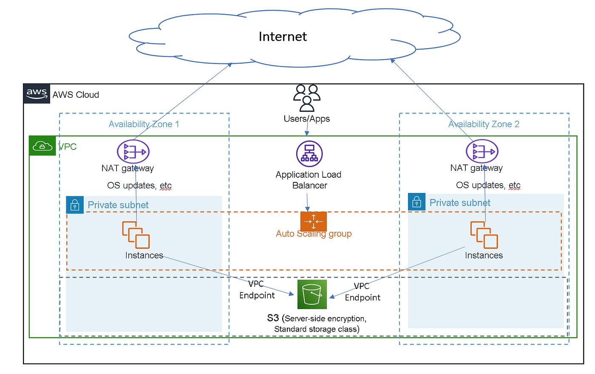
</div>

**How to read the diagram (follow the arrows):**

1. 👤 A **user** opens the website address.
2. ⚖️ The **Application Load Balancer (ALB)** in the public subnets receives the request.
3. 🎯 It forwards the visitor to a **healthy server** in a private subnet, either in **Zone 1** or **Zone 2**.
4. 🖥️ The server replies with the web page.
5. 🔄 When servers need updates, they go out through the **NAT Gateway** of their own zone.
6. 🪣 When they need files, they reach **S3** privately through a **VPC Endpoint**, without touching the public internet.

The same flow as a simple chart:

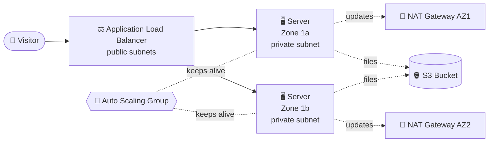

### 🗺️ Address plan

| Item | Name | Address range (CIDR) | Zone |
|------|------|----------------------|------|
| VPC | `devops-project-vpc` | `10.0.0.0/16` | Whole region |
| Public subnet 1 | `public-subnet-az1` | `10.0.1.0/24` | ap-south-1a |
| Public subnet 2 | `public-subnet-az2` | `10.0.2.0/24` | ap-south-1b |
| Private subnet 1 | `private-subnet-az1` | `10.0.11.0/24` | ap-south-1a |
| Private subnet 2 | `private-subnet-az2` | `10.0.12.0/24` | ap-south-1b |

---

## 🧰 AWS Services Used and Why

| Service | What it is (simple) | Why it's used here |
|---------|---------------------|--------------------|
| **Amazon VPC** (`devops-project-vpc`) | Your own private network in AWS | Holds every resource of the project |
| **Public + Private Subnets** | "Rooms" inside the network | Public: the Load Balancer. Private: the hidden web servers |
| **Internet Gateway** (`devops-project-igw`) | The network's front door | Lets internet users reach the Load Balancer |
| **NAT Gateways** (`nat-gateway-az1`, `nat-gateway-az2`) | A one-way back door | Private servers can fetch updates; strangers can't get in |
| **Route Tables** | Road signs for network traffic | Point public traffic to the IGW and private traffic to the NAT |
| **VPC Gateway Endpoint** (`devops-s3-gateway-endpoint`) | A private hallway to S3 | Safe, free access to storage without using the internet |
| **Amazon S3** (`devops-project-file-…`) | Online file storage | Stores project files, with server-side encryption |
| **Security Groups** (`alb-security-group`, `ec2-security-group`) | A virtual guest list | ALB accepts the public; servers accept **only the ALB** |
| **Launch Template** (`devops-webserver-template`) | A saved recipe for a server | Every new server is built identically |
| **Amazon EC2** (`t3.micro`) | A virtual computer | Runs the website |
| **Target Group** (`devops-webserver-tg`) | The list of servers the ALB may use | Runs health checks on every server |
| **Application Load Balancer** (`devops-project-alb`) | A smart traffic distributor | One address for users, traffic split across zones |
| **Auto Scaling Group** (`devops-project-asg`) | The server "manager" | Keeps 2 servers running and replaces failed ones |

---

## 🛡️ How High Availability Works

| Situation | What happens | Does the website stay up? |
|-----------|--------------|:-------------------------:|
| ✅ **Everything is fine** | The ALB shares visitors between both zones | ✅ Yes |
| 💥 **One server crashes** | The ALB's health check spots it and sends everyone to the other server | ✅ Yes |
| 🏢 **A whole data centre (zone) fails** | The server in the other zone keeps answering | ✅ Yes |
| 🔧 **A server is lost for good** | The Auto Scaling Group builds a brand-new one by itself | ✅ Yes, and back to full strength |
| 📈 **Traffic grows** | The Auto Scaling Group can add servers (up to the maximum you set) | ✅ Yes |

---

## 📸 Demo and Screenshots

### 🌐 The website is live

<div align="center">
  
</div>

### ✅ Both servers are healthy and ready

The Load Balancer only sends visitors to servers that pass their **health check**. Both servers show **Healthy** ✅, one in each Availability Zone.

<div align="center">
  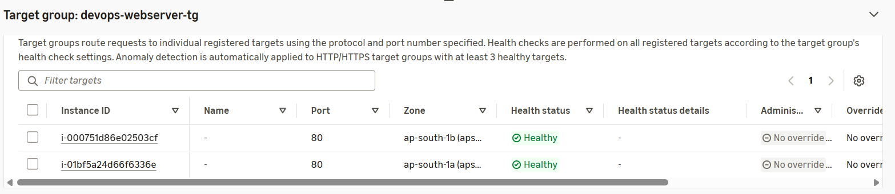
</div>

### 🤖 The Auto Scaling Group: 2 of 2 servers healthy

<div align="center">
  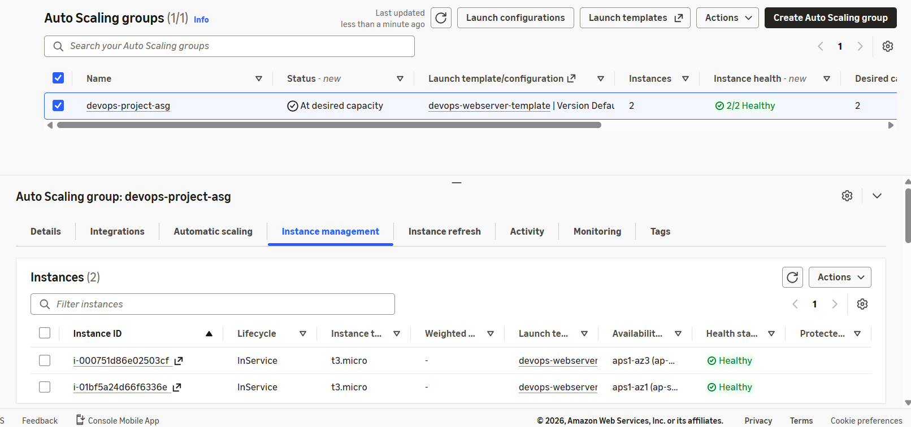
</div>

### 🖥️ Servers running in two zones

<div align="center">
  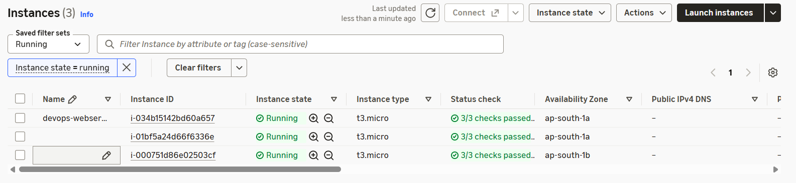
</div>

### 🧱 The network building blocks

<table>
  <tr>
    <td align="center" width="50%"><b>🛡️ VPC</b></td>
    <td align="center" width="50%"><b>🏘️ Subnets (2 public + 2 private)</b></td>
  </tr>
  <tr>
    <td>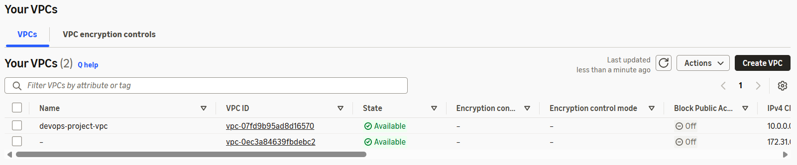</td>
    <td>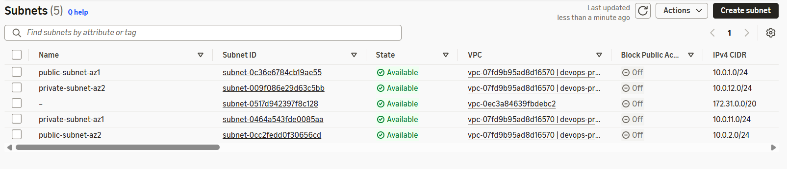</td>
  </tr>
  <tr>
    <td align="center"><b>🚪 Internet Gateway</b></td>
    <td align="center"><b>🔁 NAT Gateways</b></td>
  </tr>
  <tr>
    <td>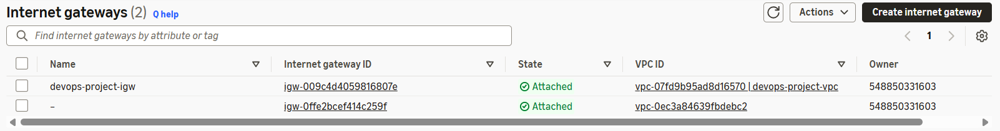</td>
    <td>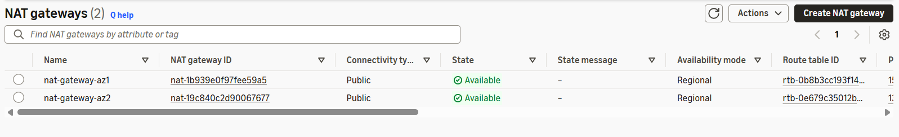</td>
  </tr>
  <tr>
    <td align="center"><b>🛣️ Route Tables</b></td>
    <td align="center"><b>🔌 S3 Gateway Endpoint</b></td>
  </tr>
  <tr>
    <td>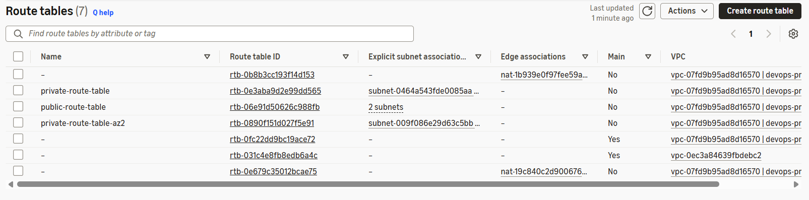</td>
    <td>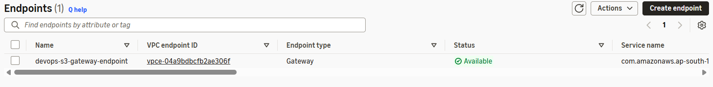</td>
  </tr>
</table>

### ⚙️ The server and traffic settings

<table>
  <tr>
    <td align="center" width="50%"><b>🪣 S3 Bucket</b></td>
    <td align="center" width="50%"><b>📋 Launch Template</b></td>
  </tr>
  <tr>
    <td>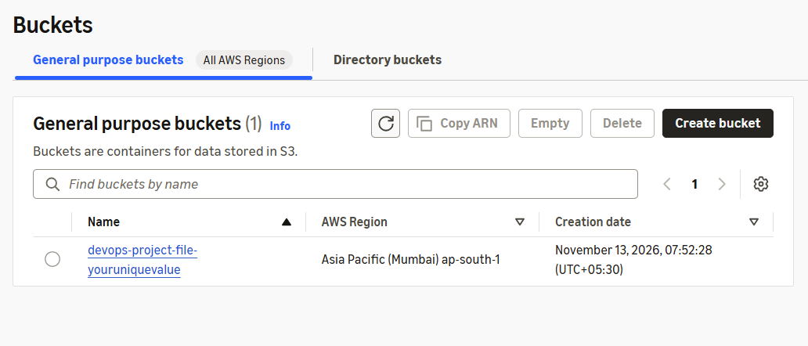</td>
    <td>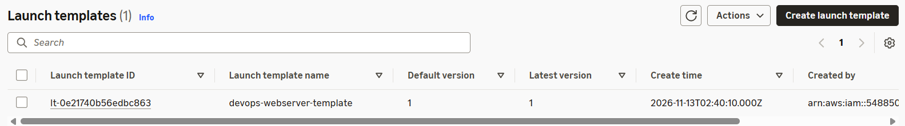</td>
  </tr>
  <tr>
    <td align="center"><b>🔒 Security Groups</b></td>
    <td align="center"><b>🎯 Target Group</b></td>
  </tr>
  <tr>
    <td>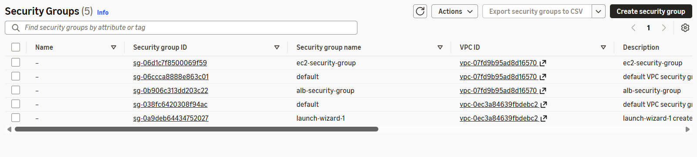</td>
    <td>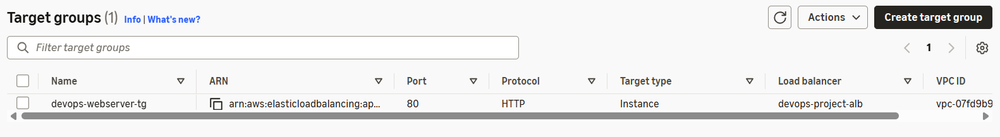</td>
  </tr>
  <tr>
    <td align="center" colspan="2"><b>⚖️ Application Load Balancer</b></td>
  </tr>
  <tr>
    <td colspan="2">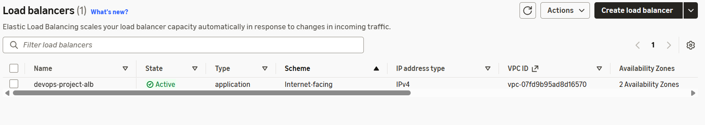</td>
  </tr>
  <tr>
    <td colspan="2">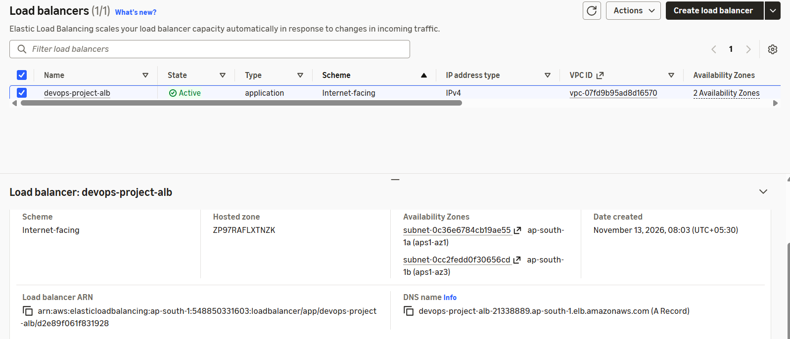</td>
  </tr>
</table>

---

## 🛠️ Step-by-Step Implementation

> 🌎 **Region used:** Asia Pacific (Mumbai), `ap-south-1`. Use the **same region** for every step.

### ✅ Prerequisites

- An [AWS account](https://aws.amazon.com/free/)
- Basic ability to click around the AWS Console
- About **60–90 minutes**

---

### Step 1️⃣ — Create the VPC (your private network)

**Where:** Console → **VPC** → *Your VPCs* → **Create VPC**

- Choose **VPC only**
- **Name:** `devops-project-vpc`
- **IPv4 CIDR:** `10.0.0.0/16`

✅ **Check:** State shows **Available**.

---

### Step 2️⃣ — Create 4 subnets

**Where:** VPC → *Subnets* → **Create subnet** (choose `devops-project-vpc`)

| Name | Zone | CIDR |
|------|------|------|
| `public-subnet-az1` | ap-south-1a | `10.0.1.0/24` |
| `public-subnet-az2` | ap-south-1b | `10.0.2.0/24` |
| `private-subnet-az1` | ap-south-1a | `10.0.11.0/24` |
| `private-subnet-az2` | ap-south-1b | `10.0.12.0/24` |

> 💡 For the two **public** subnets: *Actions → Edit subnet settings → Enable auto-assign public IPv4 address*.

---

### Step 3️⃣ — Create and attach the Internet Gateway

- **VPC → Internet gateways → Create** → name `devops-project-igw`
- **Actions → Attach to VPC** → `devops-project-vpc`

✅ **Check:** State shows **Attached**.

---

### Step 4️⃣ — Create 2 NAT Gateways (one per zone)

**Where:** VPC → *NAT gateways* → **Create NAT gateway**

| Name | Subnet (must be **public**) | Type |
|------|-----------------------------|------|
| `nat-gateway-az1` | `public-subnet-az1` | Public |
| `nat-gateway-az2` | `public-subnet-az2` | Public |

Click **Allocate Elastic IP** for each, then wait until both are **Available**.

> 💰 NAT Gateways are billed by the hour. See the [cost note](#-cost-note-and-cleanup).

---

### Step 5️⃣ — Create the Route Tables

| Route table | Route to add | Attach to subnets |
|-------------|--------------|-------------------|
| `public-route-table` | `0.0.0.0/0` → **Internet Gateway** | both public subnets |
| `private-route-table` | `0.0.0.0/0` → **NAT** `nat-gateway-az1` | `private-subnet-az1` |
| `private-route-table-az2` | `0.0.0.0/0` → **NAT** `nat-gateway-az2` | `private-subnet-az2` |

> ℹ️ AWS may also show a few unnamed route tables (the *main* ones and ones linked to the NAT gateways). That is normal. Leave them alone.

---

### Step 6️⃣ — Create the S3 Gateway Endpoint

**Where:** VPC → *Endpoints* → **Create endpoint**

- **Name:** `devops-s3-gateway-endpoint`
- **Service:** `com.amazonaws.ap-south-1.s3` (type **Gateway**)
- **VPC:** `devops-project-vpc`
- **Route tables:** both private route tables

---

### Step 7️⃣ — Create the S3 bucket

**Where:** Console → **S3** → **Create bucket**

- **Name:** `devops-project-file-<your-unique-value>` (bucket names must be unique worldwide)
- **Region:** Asia Pacific (Mumbai)
- Keep **Block all public access** ON and default encryption ON

---

### Step 8️⃣ — Create the Security Groups

**Where:** EC2 → *Security Groups* → **Create** (VPC: `devops-project-vpc`)

| Security Group | Allow | From |
|----------------|-------|------|
| `alb-security-group` | HTTP (port 80) | Anywhere (`0.0.0.0/0`) |
| `ec2-security-group` | HTTP (port 80) | **Only** `alb-security-group` |

> 🔒 **Why this matters:** visitors can reach the servers *only* through the Load Balancer. The servers are never exposed directly.

---

### Step 9️⃣ — Create the Launch Template (the server recipe)

**Where:** EC2 → *Launch Templates* → **Create launch template**

- **Name:** `devops-webserver-template`
- **AMI:** Amazon Linux 2023
- **Instance type:** `t3.micro`
- **Security group:** `ec2-security-group` (do **not** pick a subnet here)
- **Advanced details → User data:** paste [`user-data/webserver.sh`](user-data/webserver.sh)

```bash
#!/bin/bash
dnf update -y
dnf install -y httpd
systemctl enable --now httpd

cat > /var/www/html/index.html <<'HTML'
<h1>Welcome to My AWS DevOps Project!</h1>
<p>High Availability Web Application</p>
HTML
```

---

### Step 🔟 — Create the Target Group

**Where:** EC2 → *Target Groups* → **Create target group**

- **Type:** Instances, **Name:** `devops-webserver-tg`
- **Protocol / Port:** HTTP : 80, **VPC:** `devops-project-vpc`
- **Health check path:** `/`
- Do **not** register servers by hand; the Auto Scaling Group will do it.

---

### Step 1️⃣1️⃣ — Create the Application Load Balancer

**Where:** EC2 → *Load Balancers* → **Create → Application Load Balancer**

- **Name:** `devops-project-alb`, **Internet-facing**, IPv4
- **VPC:** `devops-project-vpc`
- **Subnets:** `public-subnet-az1` and `public-subnet-az2` (the **public** ones)
- **Security group:** `alb-security-group`
- **Listener:** HTTP : 80 → forward to `devops-webserver-tg`

Copy the **DNS name** of the load balancer. This is your website address.

---

### Step 1️⃣2️⃣ — Create the Auto Scaling Group

**Where:** EC2 → *Auto Scaling Groups* → **Create Auto Scaling group**

- **Name:** `devops-project-asg`
- **Launch template:** `devops-webserver-template`
- **Subnets:** `private-subnet-az1` and `private-subnet-az2` (the **private** ones)
- **Load balancing:** attach to `devops-webserver-tg`, turn on **ELB health checks**
- **Group size:** Desired `2`, Minimum `2`, Maximum `4`

✅ **Check:** the group shows **2/2 Healthy** (see the screenshot above).

---

### Step 1️⃣3️⃣ — Open your website 🎉

Paste the Load Balancer **DNS name** into your browser using **`http://`** (not https):

```
http://devops-project-alb-xxxxxxxx.ap-south-1.elb.amazonaws.com
```

You should see **"Welcome to My AWS DevOps Project!"**. Your browser may say *Not secure*. That is expected, because this project doesn't use HTTPS yet (see [Future Improvements](#-future-improvements)).

---

## 💥 Failure Test (Prove It Works)

Imagine one server crashes. 😱

1. Go to **EC2 → Instances** and select **one** server that belongs to the Auto Scaling Group.
2. Choose **Instance state → Terminate instance**.
3. Refresh your website several times. It **still works**, because the other server answers.
4. Wait **3–5 minutes**. The Auto Scaling Group notices and **builds a new server by itself**. The group returns to **2/2 Healthy**.

> 💬 **Why this matters:** on a single server this would be an outage. Here, visitors never notice.

---

## 🎓 Challenges and What I Learned

> ✏️ *Replace the rows below with problems you actually faced. Genuine lessons stand out the most.*

| Challenge | How I solved it |
|-----------|-----------------|
| Servers showed **Unhealthy** at first | Checked that `ec2-security-group` allows port 80 from `alb-security-group` and waited for the servers to finish starting |
| Private servers could not download updates | Added the `0.0.0.0/0` route to the NAT Gateway in each private route table |
| Website didn't open | Used `http://` instead of `https://` and waited until the Load Balancer was **Active** |

**Key takeaways**

- ✅ How to build a **secure network** with public and private areas
- ✅ How load balancers, target groups and health checks work together
- ✅ Why spreading servers over **two zones** protects against failure
- ✅ How Auto Scaling gives **self-healing** infrastructure

---

## 💰 Cost Note and Cleanup

This project uses billable AWS resources. The two **NAT Gateways** and the **Application Load Balancer** are usually the main costs because they are charged for every hour they exist, even with no visitors. EC2 is covered by the Free Tier only within its limits. Check current prices on the [AWS pricing page](https://aws.amazon.com/vpc/pricing/).

### 🧹 Clean up when you finish (to avoid charges)

Delete in this order:

1. **Auto Scaling Group** `devops-project-asg` (this terminates the servers)
2. **Load Balancer** `devops-project-alb`, then **Target Group** `devops-webserver-tg`
3. **Launch Template** `devops-webserver-template`
4. **Both NAT Gateways**, then **release the two Elastic IPs**
5. **VPC Endpoint** `devops-s3-gateway-endpoint`
6. **Empty and delete** the S3 bucket
7. Security groups, route tables, subnets, Internet Gateway (detach first), and finally the **VPC**

> ⚠️ Always check the AWS Billing dashboard after cleanup.

---

## 🔮 Future Improvements

- [ ] 🏗️ Automate the whole setup with **Terraform** or **CloudFormation**
- [ ] 🔐 Add **HTTPS** with AWS Certificate Manager and a custom domain (Route 53)
- [ ] 📈 Add **scaling policies** so servers are added automatically when traffic rises
- [ ] 🔔 Add **CloudWatch alarms** and notifications
- [ ] 🛡️ Add **AWS WAF** in front of the Load Balancer
- [ ] 🚦 Deploy updates with a **CI/CD pipeline** (GitHub Actions)

---

## 🔁 Use This Project in Your Own Repo

Want to try it or add it to your own portfolio?

1. **Fork** this repository (top-right button) or download it as a ZIP
2. Follow the [step-by-step guide](#-step-by-step-implementation) in your own AWS account
3. Replace the screenshots in `screenshots/` with **your own** (keep the same file names so the README keeps working)
4. Change the website text in `user-data/webserver.sh`
5. Write your own **Challenges and What I Learned** section
6. ⭐ If it helped you, give the repo a star!

> 🔐 **Before you publish screenshots:** hide (blur) your AWS **account ID** and any private details that appear in them.

### 📁 Repository structure

```
AWS-High-Availability-Web-App/
├── README.md
├── screenshots/
│   ├── 01-architecture.png
│   ├── 02-vpc.png
│   ├── 03-subnets.png
│   ├── 04-internet-gateway.png
│   ├── 05-route-tables.png
│   ├── 06-nat-gateways.png
│   ├── 07-s3-endpoint.png
│   ├── 08-s3-bucket.png
│   ├── 09-launch-template.png
│   ├── 10-security-groups.png
│   ├── 11-target-group.png
│   ├── 12-load-balancer.png
│   ├── 13-target-health.png
│   ├── 14-auto-scaling-group.png
│   ├── 15-ec2-instances.png
│   ├── 16-load-balancer-details.png
│   └── 17-website-live.png
└── user-data/
    └── webserver.sh      # Server setup script
```

---

## 👤 Author

**Avishkar Thorave**

[](https://github.com/Avishkar5658)
[](https://www.linkedin.com/in/avishkar-thorve-a77a8b2a1)

---

<div align="center">

⭐ **If you found this useful, give it a star!** ⭐

*Built with ☁️ AWS and a lot of curiosity.*

</div>
